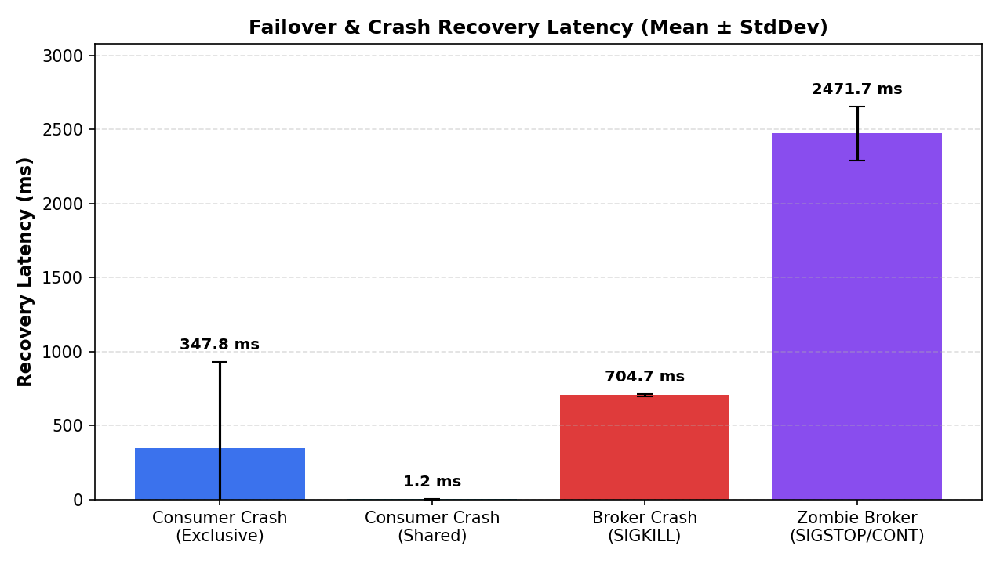
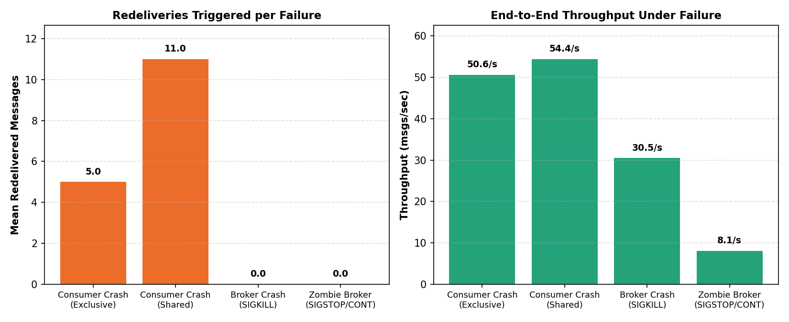

# Pulsar-Inspired Distributed Messaging System — Final Project Report

**Course**: Distributed Systems (Topic 36: Pulsar-Inspired Distributed Messaging System)  
**Authors**: Om Mehra (2025201008) & Hardik Kothari (2025201046)

---

## 1. Executive Summary

This project implements a cloud-native, distributed publish-subscribe messaging system inspired by **Apache Pulsar**. Unlike coupled architectures where brokers store message logs locally, our system strictly separates **stateless compute/routing brokers** from a **durable append-only storage service** and an **ownership coordinator** managing time-bound leases with monotonic fencing tokens.

### Core Capabilities Implemented
1. **Compute-Storage Separation**: Stateless `BrokerServer` processes route traffic while `StorageServer` persists topic logs, metadata, retention policies, and subscription cursors using `os.fsync()`.
2. **Binary Length-Prefixed Wire Protocol**: Custom 4-byte big-endian length-prefixed JSON framing over raw TCP sockets ([`protocol.md`](protocol.md)), resilient to packet fragmentation and coalescing.
3. **Flexible Subscription Semantics**:
   * **Exclusive**: Single-consumer strictly FIFO delivery (`CONSUMER_BUSY` rejection for secondary consumers).
   * **Shared**: Multi-consumer round-robin distribution with individual message acknowledgments and automatic disconnect re-pooling.
4. **At-Least-Once Delivery**: Min-heap `UnackedTracker` triggers automatic redelivery upon acknowledgment timeout or consumer crash.
5. **Lease-Based Ownership & Monotonic Fencing**: `CoordinatorServer` issues time-bound leases with persisted monotonically increasing fencing tokens ($N+1$), enforced at the storage barrier to lock out zombie brokers and prevent split-brain corruption.
6. **Multi-Subscription Retention**: Time-based and size-based log pruning that deletes messages only when past retention **and** acknowledged by every active subscription cursor.

---

## 2. System Architecture

```
      PRODUCER (Client SDK)                     CONSUMER (Client SDK)
      [client/producer.py]                      [client/consumer.py]
               │                                         ▲
               │ 1. PUBLISH                              │ 4. DELIVER
               ▼                                         │
┌────────────────────────────────────────────────────────┴───────────────────────┐
│                         BROKER LAYER (Stateless Compute)                       │
│  • ExclusiveDispatcher (FIFO) / SharedDispatcher (Round-Robin Worker Pool)     │
│  • Min-Heap UnackedTracker (At-least-once timeout redelivery)                  │
│  • Background lease heartbeats (RENEW_LEASE) & standby failover watchdog       │
└──────────────┬───────────────────────────────────────────▲─────────────────────┘
               │                                           │
               │ 2. APPEND (with fencing_token)            │ 3. READ / SAVE_CURSOR
               ▼                                           │
┌──────────────────────────────────────────────────────────┴─────────────────────┐
│                          STORAGE LAYER (Durable Disk)                          │
│  • Append-only <topic>.log with os.fsync() + seek index                        │
│  • Fencing Barrier: rejects writes if fencing_token < highest_seen_token       │
│  • Durable Cursors: mark_delete_position + individual_acks with compaction     │
│  • Retention Sweeper: prunes head only up to min(all cursor mark_delete)       │
└────────────────────────────────────────────────────────────────────────────────┘
                                           ▲
                                           │ ACQUIRE_LEASE / RENEW_LEASE / GET_OWNER
                                           │
┌──────────────────────────────────────────┴─────────────────────────────────────┐
│                      COORDINATOR LAYER (Ownership & Leases)                    │
│  • Time-bound leases preventing deadlocks on broker crashes                    │
│  • Persistent global_token_counter (os.fsync) -> strictly monotonic (1, 2, 3)  │
└────────────────────────────────────────────────────────────────────────────────┘
```

---

## 3. Ordering Guarantees & Delivery Semantics Analysis

The system guarantees **at-least-once delivery** across both subscription modes. Below are the exact ordering guarantees under normal operation, consumer crash, timeout redelivery, and broker failover:

### 3.1 Exclusive Subscription (`mode="EXCLUSIVE"`)
* **Guarantee**: **Strict per-topic FIFO ordering** (`offset 0, 1, 2, ...`).
* **Concurrency**: At most one active consumer may attach; any concurrent consumer attempting to subscribe receives `ERROR: CONSUMER_BUSY`.
* **Behavior on Crash / Redelivery / Failover**:
  * When an active consumer disconnects or when an owning broker fails over to a standby broker, the dispatcher rewinds its read pointer back to the persisted **`cursor.mark_delete_position + 1`**.
  * Any messages delivered since the last checkpointed acknowledgment (or whose ack timeout expired in `UnackedTracker`) are redelivered in exact offset order.
  * **Key Property**: **Order holds**, but **duplicates are possible** during crash windows (e.g., if a consumer processed message $k$ and crashed before its `ACK` reached storage, message $k$ is redelivered upon recovery with `redelivery_count >= 1`). Consumer applications achieve end-to-end idempotency using the immutable `(topic, offset)` `MessageId`.

### 3.2 Shared Subscription (`mode="SHARED"`)
* **Guarantee**: **No global ordering guarantee**.
* **Concurrency**: Multiple consumers connect concurrently and receive messages in a broker-driven **Round-Robin** rotation.
* **Behavior on Crash / Redelivery**:
  * Workers acknowledge individual messages out of order (`Cursor.individual_acks`), with automatic gap compaction advancing `mark_delete_position` whenever contiguous ranges complete.
  * If a worker disconnects or exceeds the acknowledgment deadline, its unacknowledged messages are moved to `_requeue_pool` and redelivered to other active workers ahead of new storage reads.
  * Because independent workers process messages at different speeds and failed tasks are re-queued to peers, offset `k+1` may complete and be acknowledged before offset `k`.

### Summary Matrix

| Property | Exclusive Mode | Shared Mode |
| :--- | :--- | :--- |
| **Max Active Consumers** | 1 (`CONSUMER_BUSY` on 2nd) | Unlimited (Worker Pool) |
| **Delivery Semantics** | At-least-once | At-least-once |
| **Ordering Guarantee** | Strict per-topic FIFO (rewinds to `mark_delete` on failure; duplicates possible) | None (parallel execution + out-of-order re-pooling) |
| **Cursor Tracking** | Cumulative `mark_delete_position` | `mark_delete_position` + `individual_acks` set with compaction |
| **Ideal Workload** | Ledgers, state machines, CDC | Background jobs, notifications, analytics |

---

## 4. Fault Tolerance & Split-Brain Prevention

The system prevents split-brain conflicts using **Time-Bound Leases + Monotonic Fencing Tokens**:
1. **Mutual Exclusion via Leases**: The coordinator grants a time-bound lease (e.g., `700 ms` TTL in chaos tests; `5000 ms` default). Active brokers renew leases via background heartbeats (`RENEW_LEASE`).
2. **Zombie Broker Problem (`SIGSTOP`/`SIGCONT`)**: If a broker pauses due to a heavy GC cycle or network partition past its lease expiry, a standby broker acquires the lease with a strictly higher fencing token ($N+1$), persisted by the coordinator via `os.fsync()`.
3. **Storage Fencing Barrier**: Every `APPEND` and `SAVE_CURSOR` call carries the broker's `fencing_token`. If the paused zombie broker wakes up and attempts to write with token $N$, `StorageServer` sees `highest_fencing_token == N+1` and immediately rejects the write with **`FENCED`**. Upon receiving `FENCED` or a failed renewal, the zombie broker demotes itself and closes stale dispatchers.

---

## 5. Multi-Run Experimental Evaluation

All experiments were executed on a **live 5-node localhost cluster** (`1 Storage`, `1 Coordinator`, `3 Brokers` spawned as independent OS subprocesses via `scripts/evaluate.py --runs 3`), totaling **12 automated chaos runs** (3 trials per scenario).

### 5.1 Aggregated Results (`results/summary.csv`)

| Scenario | Trials | Mean Recovery Latency | Min / Max Recovery | Mean Redeliveries | Mean Throughput | Messages Lost | Ordering Preserved | Zombie Fenced |
| :--- | :---: | :---: | :---: | :---: | :---: | :---: | :---: | :---: |
| **`consumer_crash_exclusive`** | 3 | **347.79 ms** | 11.91 / 1018.72 ms | 5.00 | 50.62 msg/s | **0** | Yes (`True`) | N/A |
| **`consumer_crash_shared`** | 3 | **1.25 ms** | 0.24 / 3.20 ms | 11.00 | 54.39 msg/s | **0** | No (`False`) | N/A |
| **`broker_kill_sigkill`** | 3 | **704.71 ms** | 699.54 / 711.90 ms | 0.00 | 30.47 msg/s | **0** | Yes (`True`) | N/A |
| **`broker_zombie_sigstop`** | 3 | **2471.74 ms** | 2264.36 / 2598.06 ms | 0.00 | 8.05 msg/s | **0** | Yes (`True`) | **Yes (`True`)** |

### 5.2 Visual Analysis

#### Recovery Latency Across Failure Modes


#### Redeliveries and Throughput Under Failure


### 5.3 Key Experimental Findings
1. **Zero Data Loss Across All 12 Chaos Runs**: Every single published message (`total_published == unique_delivered`, `0` lost messages) was durably persisted and acknowledged across consumer crashes, abrupt `SIGKILL` broker terminations, and `SIGSTOP`/`SIGCONT` zombie freezes.
2. **Instant Shared-Mode Peer Recovery (`1.25 ms` mean)**: In `consumer_crash_shared`, because a peer worker was already connected, the broker detected the socket close and immediately re-pooled the dead worker's 5 unacknowledged messages in ~`1.25 ms` (sub-millisecond in 2 of 3 runs).
3. **Predictable `SIGKILL` Failover (`704.71 ms`, $\sigma = 6.42\text{ ms}$)**: When the owning broker was terminated via `SIGKILL`, the OS closed TCP sockets immediately (`FIN`/`RST`). Recovery latency closely tracked the `700 ms` lease TTL required before a standby broker could safely claim token $N+1$.
4. **Silent Freeze (`SIGSTOP`) Bound by Client Timeout (`2471.74 ms`)**: Unlike `SIGKILL`, `SIGSTOP` leaves TCP sockets half-open in the kernel. Client failover waits for the `1.5 s` socket read timeout before querying `GET_OWNER` and reconnecting to the newly elected broker. Upon `SIGCONT`, all zombie write attempts were rejected (`FENCED` / `NOT_OWNER`) and the storage barrier blocked stale token writes with zero log corruption.

---

## 6. Reproducing Results & Demo

```bash
# 1. Run full unit + integration test suite (all 12 phases)
python3 -m pytest tests/ -v

# 2. Run multi-trial benchmark & regenerate plots
python3 -m scripts.evaluate --runs 3

# 3. Run interactive live demonstration
python3 -m scripts.demo
```

